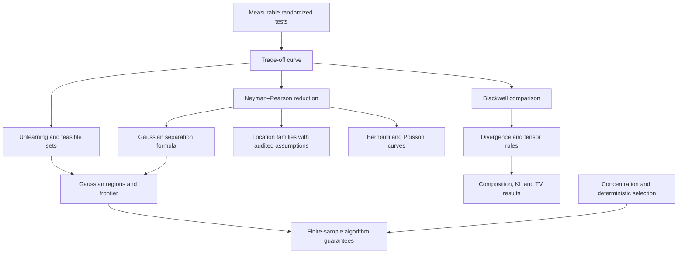

# Paper audit and formalization inventory

Paper: Aaradhya Pandey and Sanjeev Kulkarni, *Statistical Unlearning of Distributions: A Hypothesis Testing Approach*.

Pinned source: [arXiv:2605.16645v1](https://arxiv.org/abs/2605.16645v1), submitted 15 May 2026. [HTML](https://arxiv.org/html/2605.16645v1), [PDF](https://arxiv.org/pdf/2605.16645v1). First audit: 6 November 2026 (America/New_York).

This is a first mathematical audit of the numbered statements and their proof dependencies. It is not a completed formal verification of the manuscript, nor a claim that every proof line has been checked. None of the counterexamples or proposed repairs below is certified by this document itself. Kernel-checked results must be identified separately by declaration, build, commit, and axiom report.

## Source identification

Use a stable project identifier together with section, source version, and equation number. Number alone is insufficient: in the PDF, the C.1 restatement of main Proposition 3 is displayed as Proposition 11, while C.3 also contains Proposition 11. The HTML omits some repeated theorem text and points back to the earlier statement. The introduction refers to a downstream result as Lemma 9, while B.3 displays Proposition 9.

For the inventory below, displayed numbers follow the HTML; descriptive names are paraphrases. Record any later source revision as a new audit target rather than silently changing this source.

## Definitions and conventions

| Project ID | Paper location | Content and required formal choices |
|---|---|---|
| `def-tradeoff` | Definition 1, §2.1, (1) | `T(P,Q)(a)` is the infimum of `E_Q[1−φ]` over measurable tests `φ:W→[0,1]` with `E_P[φ]≤a`; P,Q are probability measures on one measurable space. Use an actual measure-theoretic definition, not an unspecified binary function advertised as the full definition. |
| `def-unlearning` | Definition 2, §2.1, (2) | Edited distribution p belongs to a specified family; pointwise removal `T(p,p₁)≤f_d` and preservation `f_c≤T(p,q₁)`. Keep the direction and order of the two measures explicit. |
| `def-feasible` | Definition 3, §2.2 | Set of distributions in the family satisfying both constraints. A parameter-space representation requires a separately proved identification with the distribution family. |
| `def-multi-unlearning` | Definition 4, C.3, (59)–(60) | All unwanted and retained constraints hold individually. Finite index types should encode zero-population cases deliberately. |
| `def-multi-feasible` | Definition 5, C.3 | Intersection of the multiple removal and preservation constraints. |

Generalized inverse convention in Lemma 17: for nonincreasing `h:[0,1]→[0,1]`, `h⁻¹(t)=inf{x∈[0,1]:h(x)≤t}`, with empty infimum equal to 1. A complete lattice on the closed unit interval implements this convention naturally. An ordinary real `sInf` without a nonempty-set argument does not implement it automatically.

## Numbered result inventory

All entries below start as **unverified targets**. A conditional abstract theorem must retain that label until its statistical hypotheses are discharged.

| Project ID | Source | Main mathematical dependencies and assumptions |
|---|---|---|
| `prop-kl` | Proposition 1, §2.1, (3) | Unlearning, reversal of trade-off ordering under generalized inverse, and KL data processing via Blackwell comparison; extended KL values and absolute continuity need explicit treatment. |
| `lemma-compose` | Lemma 2, §2.3; B.1, (35)–(36) | Product probability measures; tensor product of trade-off functions is well-defined and monotone (Proposition 8). |
| `prop-tv` | Proposition 2, §2.4, (6) | Unlearning and total-variation data processing. TV convention is half of the supremum over measurable functions bounded by 1 in absolute value. |
| `prop-gaussian-region` | Proposition 3, §3.1, (7)–(8); C.1 | Fixed positive-definite covariance Σ; nonnegative α,ε; Gaussian trade-off comparison is equivalent to comparison of Mahalanobis distances. Geometry and boundary clauses need repairs below. |
| `lemma-gaussian-frontier` | Lemma 8, §3.1, (9) | Gaussian comparison plus a constructive extremizer at distance ε from the retained center, away from the unwanted center. Nontrivial real parameter space is needed. |
| `prop-white-noise` | Proposition 4, §3.2, (16)–(18) | Isonormal Gaussian process over `L²[0,1]`; likelihood-ratio distribution (12)–(15); Gaussian comparison and Hilbert-space geometry. White noise itself is not an `L²`-valued Gaussian with identity covariance. |
| `prop-poisson-region` | Proposition 5, §3.3, (19)–(20) | Positive Poisson rates; displayed case α>1 and 0<ε<1, the latter positivity inherited from the preceding setup; Lemma 28. Other parameter regimes are tabulated in C.5. |
| `prop-random-gaussian` | Proposition 6, §4.1; D.1 | Independent groups of IID isotropic Gaussians, σ>0, sample sizes and remaining counts, weighted empirical means, concentration and a union bound. Confidence constants require reconciliation below. |
| `prop-selective-gaussian` | Proposition 7, §4.2; D.4 | Same Gaussian sampling setup; measurable distance ordering with tie handling; Lemmas 37,44,46; quantile domain and deletion endpoints need explicit restrictions or extended-valued conventions. |
| `prop-tensor` | Proposition 8, A.5, (33)–(34) | Trade-off equivalence classes, product experiment; commutativity, associativity, identity, inverse compatibility, monotonicity; Gaussian tensor parameter is Euclidean norm of component parameters. Cited from Dong–Roth–Su. |
| `prop-logloss` | Proposition 9, B.3, (39)–(40) | Cited from Allouah et al.; optimal predictors for log loss; joint and marginal KL identities. Predictor class, existence, conditional distributions and infinite losses need care. |
| `prop-logconcave-region` | Proposition 10, C.2, (49)–(58) | One-dimensional location family with symmetric log-concave Lebesgue density; Lemma 16 and interval geometry. Reverse parameter-order equivalence and connectedness claims fail under the stated assumptions; see below. |
| `prop-multi-gaussian` | Proposition 11, C.3, (61)–(62) | All Gaussian pointwise constraints; invertible covariance must be explicit because Σ⁻¹ is used. Intersection-of-balls form is correct in whitened coordinates; stated one-dimensional simplification fails below. |
| `prop-multi-logconcave` | Proposition 12, C.3, (63)–(64) | Multiple location constraints, Lemma 16, one-dimensional set intersection. Shares the log-concave identifiability and interval-union issues. |
| `prop-hilbert-region` | Proposition 13, C.4, (66)–(68) | Real separable Hilbert observation space; nonnegative self-adjoint trace-class covariance K; means restricted to the Cameron–Martin space; Lemma 26. Degenerate K and geometry clauses require care. |
| `prop-random-logconcave` | Proposition 14, D.2, (91)–(93) | Symmetric log-concave location noise; empirical means, not general MLEs; tail bound `γ_X` is an explicit probabilistic hypothesis. Geometry uses Proposition 10. |
| `prop-selective-logconcave` | Proposition 15, D.5, (122)–(128) | Same noise class with distance selection; concentration and DKW; generalized quantile needed when CDF is not invertible. |
| `prop-algorithm-comparison` | Proposition 16, D.6, (134)–(136) | One-dimensional unit-variance Gaussians; comparison of two proved numerical upper bounds. `q` is introduced in Remark 48. Domain, constants, asymptotic regime, and relation to actual algorithm performance must remain explicit. |
| `lemma-gaussian-tof` | Lemma 15, A.2, (21)–(24) | Gaussian CDF/quantiles, Neyman–Pearson reduction, whitening. Supremum assertion needs an extended parameter if separation is unbounded. Endpoint quantiles cannot be ordinary finite real inverses. |
| `lemma-logconcave-tof` | Lemma 16, A.3, (25)–(27) | Symmetric log-concave density; monotone likelihood ratio and threshold tests. Stated strict order identification has a counterexample below. |
| `lemma-inverse-order` | Lemma 17, A.4 | Pointwise `f≤g` implies generalized inverse `f⁻¹≤g⁻¹`. Sublevel set inclusion proves this; nonincreasing hypotheses are stronger than necessary for the order implication alone. |
| `theorem-blackwell` | Theorem 19, A.5, (28) | Ordering of binary experiments iff a Markov kernel maps both source laws to target laws; cited from Dong–Roth–Su. Audit the exact measurable-space regularity required for the converse before importing a theorem with stronger generality. |
| `lemma-divergence-order` | Lemma 20, A.5, (29)–(32) | A functional satisfying data processing factors through a trade-off function and is antitone; depends on Blackwell equivalence, including its regularity scope. |
| `lemma-cameron-martin-tof` | Lemma 26, C.4 | Cameron–Martin likelihood ratio and its Gaussian laws; inverse square root must be defined on the proper range, with kernel handled explicitly. |
| `lemma-poisson-order` | Lemma 28, C.5, (73) | Positive rates; trade-off comparison equivalent to common thinning plus Poisson addition, and to orientation/difference/ratio inequalities. Proof uses Lemmas 29,31; equal-rate cases need a separate branch because displayed reconstruction divides by `|a−b|`. |
| `lemma-poisson-slopes` | Lemma 29, C.5 | Positive unequal Poisson rates; endpoint slopes from essential extrema of likelihood ratio. |
| `lemma-hellinger-dpi` | Lemma 31, C.5, (74)–(82) | `Q≪P`, real exponent t, Markov kernel; Jensen/data processing with direction depending on t. Zero densities, negative powers and infinite integrals need deliberate conventions. |
| `lemma-binomial-region` | Lemma 34, C.6, (84)–(86) | Binomial family, n≥1, parameters in (0,1), baselines centered at 1/2; depends on Lemma 35, whose orientation criterion fails. |
| `lemma-binomial-order` | Lemma 35, C.6, (87) | Claims equivalence of Binomial and Bernoulli order criteria. Its similarly-ordered condition has a direct complement-symmetry counterexample below. |
| `lemma-bernoulli-curve` | Lemma 36, C.6 | Piecewise affine formula for Bernoulli trade-off curve; a,b in (0,1), with cases b>a,b<a,a=b. Attractive finite-model milestone. |
| `lemma-gaussian-mean-tail` | Lemma 37, D.1, (88) | n≥1 IID isotropic Gaussians, σ>0, δ∈(0,1); Laurent–Massart chi-square tail. |
| `lemma-dkw` | Lemma 44, D.4 | IID real observations, empirical CDF and uniform deviation bound; positive sample size and confidence parameter. |
| `lemma-selected-mean` | Lemma 46, D.4, (97)–(98) | Gaussian samples; mean of the k closest unwanted observations to retained empirical mean; radius control, order-statistic quantile, DKW and mean concentration. Prove deterministic selection bound separately from probability. |

Remarks also carry mathematical content: Remark 3 gives an infinite-divisibility limit assertion from an external theorem; Remarks 38–40 give additional random-removal bounds; Remarks 41–43 discuss tail choices and Laplace medians; Remark 48 derives the numerical comparison. These are dependencies or separate future targets, not automatically verified by formalizing the numbered propositions.

## Concrete findings requiring revision or clarification

These are mathematical audit findings. Preserve the original statement and a separate proposed replacement. Do not strengthen assumptions silently, and do not claim the paper is verified by proving a repaired theorem.

### A1: zero removal threshold in the Gaussian geometry

Proposition 3 permits α=0. In one dimension with Σ=1, μ₁=ν₁=0 and ε=1, every point of the retained closed ball satisfies `|μ−μ₁|≥0`. Thus the feasible region is the entire retained ball, while `Δ−ε≥α` reads `−1≥0` and is false.

The whole-ball criterion for a nontrivial real normed parameter space is `max(Δ−ε,0)≥α`. For α>0 it reduces to the stated `Δ−ε≥α`. The same endpoint issue occurs in Propositions 4,10,13. For general covariance, the ball is in the Mahalanobis metric or in whitened coordinates; in original coordinates it is generally an ellipsoid.

### A2: several forbidden intervals cannot generally be replaced by their hull

In the one-dimensional clause of Propositions 11 and 12, take unwanted centers −2 and 2, both removal radii 1, retained center 0 and preservation radius 1/2. Every point of `[−1/2,1/2]` is at distance at least 3/2 from each unwanted center. The exact constraint set is therefore the full retained interval. The displayed simplification excludes the entire hull `(−3,3)`, so returns the empty set.

The safe general formula is

`(⋂ⱼ [νⱼ−εⱼ,νⱼ+εⱼ]) \ (⋃ᵢ (μᵢ−αᵢ,μᵢ+αᵢ))`.

A merged-interval algorithm may simplify that union, but its gaps must be retained. The printed simplification would need an additional condition ensuring that the open forbidden intervals cover the appropriate hull.

### A3: bounded-support log-concave noise loses strict distance identification

Lemma 16 allows the symmetric log-concave Lebesgue density of `Uniform[−1/2,1/2]`. For shifts 1 and 2, the original law and shifted law are mutually singular (the touching endpoint at shift 1 has zero probability). Hence both trade-off curves are identically zero. Taking ε₁=2 and ε₂=1 gives `f_{ε₁}≥f_{ε₂}`, although `ε₁≤ε₂` is false.

Monotonicity in the forward direction can survive; recovery of the parameter order does not follow under the printed assumptions. Propositions 10 and 12 use that recovery. An everywhere positive log-concave density is a possible repair to investigate and prove; it is not adopted without proof here. The ordinary inverse-CDF assertions in Proposition 15 also need revision for bounded support or flat portions.

### A4: the one-location feasible set can be disconnected

Even with standard Gaussian noise, take μ₁=ν₁=0, α=1, ε=2. The exact parameter set in (58) is `[−2,−1]∪[1,2]`. Thus Proposition 10's claim that the remaining nonempty case is an interval is false in general. The set formula in (58), which permits two components, is the suitable formal target.

### A5: Binomial complement symmetry contradicts the orientation condition

For every n≥1, the bijection `k↦n−k` maps a `Binomial(n,a)` law to `Binomial(n,1−a)` and preserves testing errors when applied to both laws. Therefore

`T(Binomial(n,1/5),Binomial(n,4/5)) = T(Binomial(n,4/5),Binomial(n,1/5))`.

These parameter pairs have opposite orientation, contrary to the necessity of being similarly ordered in Lemma 35. For n=1, the equality also follows directly from Lemma 36's two printed branches: breakpoint 1/5, slopes −4 and −1/4. Lemma 34 inherits the issue. This is present in the PDF (printed page 30), not merely HTML conversion.

### A6: confidence constants and sample-count boundaries

Propositions 6 and 7 define `sqrt(n) γ(n,d,δ)` using `log(1/δ)`. Appendix Lemma 37 instead assigns that expression to `γ(n,d,2δ)`; its proofs use `γ(...,δ)` for events with failure probability δ/2. The two definitions must be reconciled before certifying the advertised joint confidence. This is an inconsistency requiring a proof audit, rather than by itself a counterexample to the final probability claim; the weighted Gaussian mean can also be bounded directly.

If `n₁′=0`, displayed intermediate empirical means divide by zero. If the quantile argument `n₁′/n₁+d(n₁,δ)` is at least 1, the stated ordinary finite quantile is outside its domain. Specify positive sample counts, handle full deletion separately, and either restrict the quantile argument or use an extended value with a clear vacuity interpretation.

### A7: degenerate Cameron–Martin space

Lemma 26 and Proposition 13 allow K=0. Its Cameron–Martin space is `{0}` and the shifted family has one law. With α=ε=1 and Δ=0, the numerical criterion `Δ+ε≥α` holds, but no distribution in that family has positive removal separation. The existence and frontier claims therefore need a nontrivial Cameron–Martin space, or a separate degenerate case.

### A8: additional statements needing exact assumptions

Theorem 19's converse on arbitrary measurable spaces must be compared with the cited source's hypotheses before implementation. Lemma 15's arbitrary supremum needs an infinite-separation parameter for unbounded sets, and a convention for empty index sets. Gaussian quantile formulas at error budgets 0 and 1 need endpoint definitions. Proposition 16 compares particular sufficient numerical bounds; that comparison does not establish a minimax computational lower bound or an exact algorithmic Pareto frontier. Its constants and asymptotic sample-size assumptions need a separate audit.

## Proposed dependency structure

The difficult analytic bridges should be explicit work items. An abstract order argument parameterized by a proposed trade-off function, or Euclidean geometry alone, verifies that layer only. In particular, a proof assuming the Gaussian trade-off identity has not verified that identity.

## First milestones

1. Formalize the closed-unit-interval generalized inverse and prove Lemma 17, including empty sublevel sets. No probability theory is needed.
2. Formalize Definition 2's order-level logic, weakening of baselines, and feasible-set membership. Label these abstract consequences until linked to Definition 1.
3. Prove deterministic distance constraints, the triangle upper bound `α≤Δ+ε`, and a constructive one-dimensional extremizer. Prove the A1/A2/A4 geometric counterexamples with exact rational constants.
4. Build the actual measure-theoretic randomized-test definition. Show admissible tests are nonempty, errors lie in [0,1], the curve is antitone, and the identical-law curve equals `1−a`.
5. Complete the finite Bernoulli curve and complement-symmetry theorem; use them to certify A5 and derive a corrected comparison criterion.
6. Prove the Gaussian experiment-to-distance bridge, then connect it to the already verified geometry. Only then mark the statistical portion of Proposition 3 verified, with repaired clauses separately identified.
7. Expand to product kernels, KL/TV consequences, Poisson comparison, and finite-sample concentration. Hilbert-space Gaussian measures and white noise should remain later milestones.

Keep each milestone small enough to check with pinned Lean/mathlib, no `sorry`, no custom axioms, and a declaration-level axiom report. Mathematical hypotheses belong in theorem statements; they must not include the desired conclusion in disguised form.
